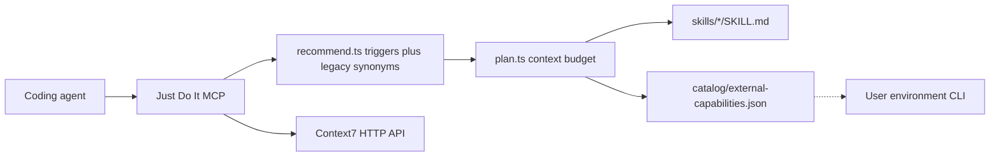

# Capability integration report

**Date:** 2026-10-21 (auth contract verified same day)  
**Scope:** Just Do It MCP catalog, selection, external tool calling, skill content.  
**Not claimed:** a live call to Context7, a Playwright browser run, a Graphify index, or an REA session.

## Context7 authentication contract — verified finding

`packages/mcp/src/lib/encryption.ts` (inspected 2026-10-21) exports `generateHeaders()`. It builds:
- `X-Context7-Source`, `X-Context7-Server-Version` — fixed telemetry
- `mcp-client-ip-assertion` — AES-256-GCM of the caller's IP, keyed by `MCP_CLIENT_IP_ASSERTION_KEY` (a 64-hex-char pre-shared key). Skipped if the key is absent.
- `mcp-session-id` — optional session continuity header
- `Authorization: Bearer <apiKey>` — when an API key is present
- IDE/transport telemetry headers

This header set is used by **Context7's own MCP server** when calling its backend (`CONTEXT7_API_BASE_URL`). The IP assertion requires `MCP_CLIENT_IP_ASSERTION_KEY` — a server-to-server symmetric secret that external callers do not have.

**Our implementation (`src/integrations/context7.ts`):**
- Sends `Authorization: Bearer` when `CONTEXT7_API_KEY` is set — correct for public callers
- Does NOT send the IP assertion or telemetry headers — correct; they require internal keys
- Calls the same REST paths (`/v2/libs/search`, `/v2/context`) via GET — correct
- Uses 10-second timeout vs upstream 60-second — intentional; we are not a latency-insensitive server-side proxy
- Uses native `fetch` vs upstream `undici` — acceptable; the public endpoint does not require undici internals

The public MCP endpoint `https://mcp.context7.com/mcp` (`server.json` `remotes[].headers`) lists only `Authorization` — our authentication mechanism is correct.

**No defects found. No upstream source was copied.**

## A. Current-state findings

### What the server already was

Just Do It is a Streamable HTTP MCP server (`src/mcp/server.ts`, `src/index.ts`, `src/app.ts`). It authenticates bearer tokens, checks scopes, and registers tools on an SDK `McpServer`. Catalog reads come from `skills/*/SKILL.md` through `src/catalog/skillFiles.ts` and `src/skills/catalog.ts`. Search returns summaries. `get_skill` returns one body plus sha256 and provenance. `recommend_skills` ranks summaries in `src/skills/recommend.ts`. Memory tools are separate. Nothing in the MCP path executes skill scripts. That boundary stayed.

### Why the requested projects were not integrated

The prior product decision in `docs/source-policy.md` and `docs/decisions/ADR-002-oss-self-host.md` treated the brainstorm inventory as research, not a shipping backlog. A later edit removed the inventory from `docs/implementation.md` and kept a single manifest source, `just-do-it-local`. Context7, Playwright, REA, Strix, and Ponytail were explicitly classed as out of the MCP surface. The five example skills remained the whole catalog. Selection depended on a hardcoded synonym map in `recommend.ts` aimed at those five ids. There was no planner, no external capability registry, and no caller for another MCP server. Naming a project in a rejected manifest row is not integration.

### What was useful, incomplete, or obsolete

| Piece | Judgment |
|---|---|
| Import gate, provenance, digest, read-only MCP | Keep. Third-party text still does not enter `skills/` without a license decision. |
| Summary-first search | Keep. Bodies stay out of search results. |
| Keyword ranker and eval harness | Keep, and extend. The synonym map is now legacy for the original seeds. New skills declare `triggers`. |
| Five example skills | Keep. They still match the original engineering tasks. |
| “External inventory is rejected, so do not build the capability” | Obsolete as a blanket rule. Studying an architecture and calling a documented API are not the same as redistributing source. |

## B. External project analysis

Recovered from the 2026-10-19 implementation draft (transcript `3b32cafa-1b69-4c4b-84f3-94ae1b9d8c90`). Rows 13–17 in that draft swapped Context7 and Graphify labels and pasted the Context7 blurb onto Strix. The URLs below are the ones that were requested. License SPDX values are from the GitHub API on 2026-10-21 unless noted.

| Project | Repo inspected | License seen | Decision |
|---|---|---|---|
| Agent Skills | [addyosmani/agent-skills](https://github.com/addyosmani/agent-skills) tree of `skills/*/SKILL.md` | MIT | Do not import the corpus. It overlaps skills this repo and the local agent-skill set already express (review, tests, context, security). Adopt the pattern already in use: one directory, one concern, description used for selection. |
| Ponytail | [DietrichGebert/ponytail](https://github.com/DietrichGebert/ponytail) root listing, `plugin.yaml`, `skills/ponytail/SKILL.md` from the local cache at version 5.3.2, `hooks/` file names | MIT | Independent skill `smallest-change`. Do not copy the skill text. Do not port hooks (`pre_llm_call`, client hook JSON, statusline scripts). Those execute inside a client and are not portable catalog content. |
| Taste Skill | [Leonxlnx/taste-skill](https://github.com/Leonxlnx/taste-skill) `skills/taste-skill/SKILL.md` front matter and opening structure | MIT | Idea only: choose a direction, then check it in a browser. No copy of the direction library or `scripts/draw.mjs`. Covered by `interface-review` and `browser-verification`. Image-to-code is the same repo path, not a second integration. |
| Vercel web design guidelines | [vercel-labs/agent-skills](https://github.com/vercel-labs/agent-skills) `skills/web-design-guidelines/SKILL.md` front matter | GitHub `license` field was **null**. No root `LICENSE` in the contents listing. | Unresolved for redistribution. Do not mirror the skill. `interface-review` points at the guidelines URL the skill itself fetches: `https://raw.githubusercontent.com/vercel-labs/web-interface-guidelines/main/command.md`. |
| Awesome Design MD | [VoltAgent/awesome-design-md](https://github.com/VoltAgent/awesome-design-md) README | MIT | Do not vendor `DESIGN.md` files. Instruction: follow one project design file; do not merge brands. |
| Playwright CLI | [microsoft/playwright-cli](https://github.com/microsoft/playwright-cli) README (install, `--help`, token-cost note vs MCP) | Apache-2.0 | `browser-verification` plus registry entry `playwright-cli`. Server does not spawn the CLI. Install state is unknown. |
| REA | [morluto/rea](https://github.com/morluto/rea) skill headings in `.agents/skills/reverse-engineer-anything/SKILL.md`, `docs/mcp-contracts.md` headings (tool results, evidence, `tools/list`, untrusted target content) | MIT | Do not copy the skill or the tool surface. `repo-orientation` covers source repos: entry points, cited vs inferred. Binaries, firmware, and debuggers stay on a tool the user runs. This server does not decompile. |
| Find Skills | [vercel-labs/skills](https://github.com/vercel-labs/skills) `skills/find-skills/SKILL.md` | MIT | Do not wrap `npx skills` or skills.sh. `find-catalog-skill` searches this catalog only. |
| Genjutsu | [AThevon/genjutsu](https://github.com/AThevon/genjutsu) `LICENSE` (MIT text plus a third-party notice), `skills/_jutsu/orchestration/SKILL.md` headings | GitHub SPDX `NOASSERTION`; file text is MIT | Unresolved if someone later vendors `skills/_jutsu/ui-ux-pro-max/`. Not copied. Adopted idea: state a thesis before new UI. Orchestration subagents were not built. |
| UI/UX Pro Max | [nextlevelbuilder/ui-ux-pro-max-skill](https://github.com/nextlevelbuilder/ui-ux-pro-max-skill) skill headings, search-script workflow | MIT | Do not vendor the CSV dataset or `search.py`. Interface checks in `interface-review` are original and short. |
| Task Observer | [rebelytics/one-skill-to-rule-them-all](https://github.com/rebelytics/one-skill-to-rule-them-all) `SKILL.md` front matter | CC-BY-4.0 | Do not copy the text. Copying it later would require attribution under CC-BY-4.0. Independent path: `session-skill-review` plus `draft_skill_candidate`, which returns markdown and `persisted: false`. No session watcher and no always-on hook. |
| Context7 | [upstash/context7](https://github.com/upstash/context7) README tool section, `server.json` remote `https://mcp.context7.com/mcp`, `packages/mcp/src/lib/tool-names.ts` (tool names `resolve-library-id`, `query-docs`), `docs/agentic-tools/ai-sdk/tools/*.mdx` (input schemas), `packages/mcp/src/lib/api.ts` (URL paths `/v2/libs/search`, `/v2/context`), `packages/mcp/src/lib/encryption.ts` (auth contract) | MIT | Dependency integration — documented HTTP interface only; no source vendored. **Auth contract verified 2026-10-21:** The public REST endpoints accept `Authorization: Bearer <key>` (optional). The upstream `encryption.ts` also adds `X-Context7-Source`, `mcp-session-id`, and an AES-256-GCM IP assertion (`mcp-client-ip-assertion`) when `MCP_CLIENT_IP_ASSERTION_KEY` is set. These are **internal server-to-server headers** used only when Context7's own MCP server calls its backend with a pre-shared symmetric key. Our implementation correctly omits them. We use `Authorization: Bearer` which is the documented public authentication mechanism (verified in `server.json` `remotes[].headers`). |
| Graphify | [Graphify-Labs/graphify](https://github.com/Graphify-Labs/graphify) README (tree-sitter AST, `EXTRACTED` vs `INFERRED`, `graph.json`, query instead of re-reading files) | Apache-2.0 | Do not add the `graphifyy` package. `repo-orientation` says to query `graphify-out/graph.json` if the user already has one. Context budget in `plan_capabilities` is the local version of “do not dump the tree.” Verified vs inferred evidence already existed on recommendations. |
| Strix | [usestrix/strix](https://github.com/usestrix/strix) README headings only (multi-agent pentest, exploit runtime, skill installer) | Apache-2.0 | **Excluded.** Autonomous offensive testing, exploit sandboxes, and proof-of-concept runs are out of this product. `defensive-review` names missing controls and forbids exploit steps. The README’s attack toolkit was not transcribed. |

Other systems considered and not adopted as dependencies: the MCP TypeScript SDK this repo already uses (tool schemas, Streamable HTTP), and the Agent Skills layout (directory plus front matter), which was already the catalog format. No new npm dependency was added.

## C. Architecture decisions

1. The agent calls `plan_capabilities` with the task.
2. Ranking uses summaries only. A declared `triggers` phrase is a substring match (+16). The old synonym map still helps the original five skills. It is not the place to register new skills.
3. The plan loads skill bodies until `contextBudgetBytes` (default 12000). Further matches stay metadata. The agent calls `get_skill` only for `includeBody: true`.
4. `requires` is matched against the external registry. Context7 becomes `call_external` steps (`resolve-library-id`, then `query-docs`). Playwright becomes `check_user_tool` with execution `user_environment`.
5. Results come back as JSON. The next model turn sees the plan, then the body, then the docs payload or a `disabled` payload that includes the MCP URL and schema. Disabled is a normal tool result so the agent can call Context7 itself.
6. Context size is the byte budget plus summary-first search. Generic id tokens (`review`, `skill`, `service`, …) do not score, because they collided on the eval set.
7. A new capability is a `SKILL.md` with `triggers` / `requires` / `provides` / `outputs`, or a row in `catalog/external-capabilities.json`. The core server does not grow a new synonym entry. `draft_skill_candidate` can propose a file. It does not write one. Import still goes through the existing gate.

Ponytail-style client hooks were rejected because they run code in the IDE. A catalog instruction the agent loads on demand is the portable equivalent.

## D. Implementation changes

### Modules

- `src/catalog/schema.ts`, `src/catalog/skillFiles.ts` — optional `triggers`, `requires`, `provides`, `outputs`
- `src/skills/recommend.ts` — trigger phrase score; generic id tokens ignored; `requires` show up as prerequisites with status `unknown`
- `src/skills/plan.ts`, `src/skills/catalog.ts` `plan()` — workflow and context budget
- `src/skills/draft.ts` — in-memory SKILL.md draft
- `src/integrations/registry.ts`, `src/integrations/context7.ts` — registry and Context7 HTTP caller
- `src/mcp/server.ts` — `plan_capabilities`, `list_external_capabilities`, `call_external_capability`, `draft_skill_candidate`
- `catalog/external-capabilities.json` — Context7 and Playwright CLI metadata

### Skills

Original five kept and given triggers where the eval used words that were only in the synonym map (`flyway`, `liquibase`, `flaky`). New files:

`smallest-change`, `current-library-docs`, `repo-orientation`, `interface-review`, `browser-verification`, `find-catalog-skill`, `session-skill-review`, `defensive-review`

### Dependencies

None added. Context7 is an HTTP call, not an npm package.

### Compliance still open

- `vercel-labs/agent-skills` has no SPDX license from the GitHub API. Do not copy `skills/web-design-guidelines/` until a human records the license and an immutable commit.
- Genjutsu’s API license is `NOASSERTION` even though the `LICENSE` file starts with MIT and then names a vendored UI/UX dataset. Do not copy that tree until a human accepts the upstream notice.
- Task Observer text is CC-BY-4.0. Not copied. A future copy needs attribution.
- Context7 proxy is operator-opt-in. The API key is read from `CONTEXT7_API_KEY` and is not logged or returned. Tests use a fake key and a mocked `fetch`.

## E. Verification

| Check | Result |
|---|---|
| `npm test` | 17 files, 113 tests, all passed (2026-10-21) |
| `npm run typecheck` | passed |
| `npm run eval:recommend` | self-check passed, `fabricationCount` 0 |

Eval fixture `eval/recommend-eval.json`, 29 cases. Recommend mode (`metadata_weighted_v1`) versus equal-weight token baseline, same cases:

| Metric | Baseline | Recommend |
|---|---|---|
| Hit@3 | 0.957 (22/23) | 1.000 (23/23) |
| Precision@3 | 0.590 (14.17/24) | 1.000 (23/23) |
| Abstain accuracy | 0.833 (5/6) | 1.000 (6/6) |

This is a small hand-written fixture. It is evidence that the ranker beats the keyword baseline on these cases. It is not a production accuracy rate and not a latency or token-cost measurement. No latency benchmark was run.

Scenarios covered in `tests/capabilities.test.ts`:

- Trigger selection without a new synonym entry
- Plan includes `current-library-docs` plus `resolve-library-id` and `query-docs`
- A 200-byte budget holds the body and records skipped bytes
- Playwright is a user-environment check, not a server run
- Context7 proxy disabled does not call `fetch` and returns the MCP URL
- Mocked `fetch` hits `https://context7.test/api/v2/libs/search` and does not echo the API key
- Missing `libraryId`, unknown tool, and Playwright invocation are rejected
- HTTP 503 is `upstream_error`
- Skill draft is not persisted; a path-escape name is rejected

`tests/app.test.ts` lists the four new tools on `tools/list`.

**Not verified against live services:** Context7 production, Playwright, Graphify, REA, and any client UI. Mocked HTTP is not a successful live integration.

## E2. Execution harness verification classes

Checked 2026-10-22. Detail is in `docs/skill-execution-report.md`.

| Class | What ran | Result |
|---|---|---|
| Deterministic orchestration | `tests/harness.test.ts` against the real catalog, temp workspaces, and graders | Pass. Failures, timeouts, blocked commands, and redaction stay failures. |
| Simulated agent | `npm run eval:skills` — 13 scripted scenarios | 13 pass. `operationallyValidated` is false on every row. |
| Live model | `npm run eval:skills -- --live` with no `JUST_DO_IT_EVAL_*` | 13 blocked. Exit code 1. Not counted as passes. |
| Local integration | Catalog read, plan, and Context7 proxy-off path inside the harness | Pass. No browser process. No database server. |
| Live external service | Context7 with a real key, Playwright CLI, Graphify, REA | Not run. |

## F. Next steps

1. Human decision on `vercel-labs/agent-skills` license before any guideline text is stored in this repo.
2. Human decision on Genjutsu’s vendored dataset if a local design search is ever required. Until then, keep the short original checklist.
3. Operator enablement: set `JUST_DO_IT_EXTERNAL_CALLS=enabled` and `CONTEXT7_API_KEY` on a machine that is allowed to call Context7, then run one live `resolve-library-id` and record the result. Do not treat the mocked test as that run.
4. If Playwright must be verified, run `playwright-cli --help` in the user environment. The server should keep refusing to spawn it.
5. Grow the eval set with real tasks that previously abstained (Kubernetes, crypto, cooking). Do not add those skills unless a team needs them.
6. Leave Strix, Ponytail hooks, and REA’s binary tool surface out unless a later review explicitly accepts that risk and a separate execution boundary.
